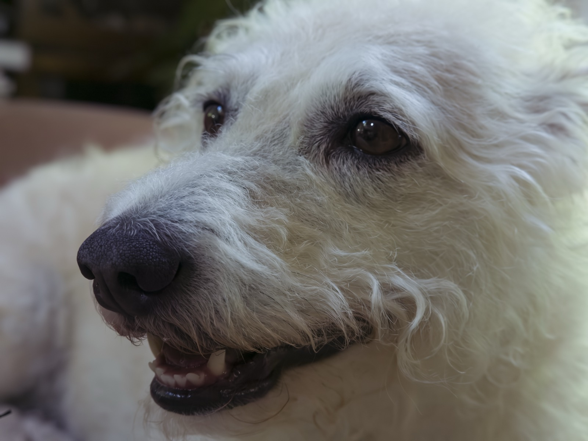

# Hasselblad Focus Distance Retrofit

Your Hasselblad X2D II RAW files from before firmware 1.3.16.1 contain everything needed to know the focus distance, but Lightroom and Capture One can't see it. This tool fixes that, without touching your originals.

In practice, this means: Lightroom and Capture One apply lens corrections (distortion, vignetting, that kind of thing) based on how far away the camera thinks it was focused. Without a focus distance, they assume you were focused far away, which is wrong on close-up shots and makes the correction visibly off. Once a file has been through this tool, the correction is tuned for the actual focus distance, and close-up shots correct properly. The before/after pair below shows the difference.

## Before and after




*(Images are on the way. The screenshots above are placeholders until real exported JPEGs are added to `docs/images/`.)*

## Is this safe?

Yes. Three things make this low-risk:

- **Your original files are never modified.** The tool only reads them.
- **The files with the fix applied, which this guide calls "retrofitted copies," are written as new files**, into a new folder (called `retrofitted` by default, sitting next to your originals). Your originals stay exactly where they were.
- **The whole tool is one readable file**, `hb-focus-retrofit.py`, and the source is open for anyone to check. If you want to verify for yourself that it never sends anything over the internet, search the file for the words `urllib`, `socket`, and `requests`. You won't find any of them; the tool has no networking code at all.

If you ever want to undo this, just delete the `retrofitted` folder. Your originals were never touched.

## What you need

- A Mac, a Windows PC, or a Linux machine.
- Python 3.9 or later. Most Macs already have this. If yours doesn't, the steps below will tell you exactly what to do.
- Nothing else. This tool doesn't need any extra libraries or installers beyond Python itself, there's no separate "install" step for the tool.

The rest of this guide is written for a Mac, since that's the most common setup for Hasselblad shooters. Windows notes are called out separately wherever the steps differ, but there's one substitution that applies everywhere: **on Windows, type `python` wherever this guide shows `python3`.** Also, any path that starts with `~/` (like `~/Desktop`) is Mac shorthand for your home folder; on Windows the equivalent looks like `C:\Users\yourname\Desktop`, or you can just drag the folder into the window as described below and skip typing the path by hand entirely.

### Checking you have Python (Mac)

Terminal is just a window where you type instructions instead of clicking buttons. Typing the commands in this guide cannot break your Mac, at worst a command does nothing or prints an error you can read and undo.

1. Open **Terminal**. You'll find it in `Applications > Utilities > Terminal`.
2. Type this and press Return:

```
python3 --version
```

3. If you see something like `Python 3.11.5`, you're set, skip ahead to **Quick start**.
4. If instead a dialog pops up asking to install "command line developer tools," click **Install**. This is Apple's own toolkit, not something from this project, and it includes Python. It takes a few minutes. Once it finishes, run `python3 --version` again to confirm.

### Checking you have Python (Windows)

1. Open **PowerShell**. Click the Start menu, type `PowerShell`, and press Return on "Windows PowerShell."
2. Type this and press Return:

```
python3 --version
```

3. If you see something like `Python 3.11.5`, you're set. If Windows says it doesn't recognize `python3`, try `python --version` instead, some Windows installs use that name.
4. If neither command works, install Python from [python.org/downloads](https://www.python.org/downloads/). During setup, check the box that says "Add Python to PATH," this is what lets Terminal/PowerShell find it afterward.

## Quick start

Five steps: get the code, move into its folder, do a dry run, read the report, then apply for real. Reminder: on Windows, type `python` instead of `python3` in every command below, and use your own folder's real path (a Windows path or the drag-in trick) instead of the Mac-style `~/Desktop/...` examples.

**1. Get the code.**

The easiest way, no prior tools needed: go to [github.com/kmichels/hasselblad-focus-retrofit](https://github.com/kmichels/hasselblad-focus-retrofit), click the green **Code** button, choose **Download ZIP**, and unzip it. GitHub usually names the unzipped folder `hasselblad-focus-retrofit-main` (with `-main` on the end), not just `hasselblad-focus-retrofit`, so check the exact name in Finder or File Explorer before the next step.

If you already use git, cloning works too:

```
git clone https://github.com/kmichels/hasselblad-focus-retrofit.git
```

That gives you a folder named exactly `hasselblad-focus-retrofit`, no `-main` suffix.

**2. Move into that folder.**

Use the folder name you actually see on disk. If you downloaded the ZIP:

```
cd hasselblad-focus-retrofit-main
```

If you used git clone:

```
cd hasselblad-focus-retrofit
```

If either command says something like "no such file or directory," you're not in the right starting location, or the folder has a different name than expected. Type `cd ` (with a trailing space, no Return yet), then drag the folder itself from Finder or File Explorer into the Terminal/PowerShell window. It will fill in the exact path for you. Then press Return.

**3. Copy your files off the memory card, then do a dry run.** Copy your 3FR files from the camera's memory card to a folder on your computer first, for example a folder on your Desktop, the same way you'd normally import a shoot. A dry run only reports what the tool *would* do. It writes nothing. Point `--source` at that folder:

```
python3 hb-focus-retrofit.py retrofit --source ~/Desktop/X2D-Import
```

**Replace `~/Desktop/X2D-Import` with the actual location of YOUR folder.** It's an example, not a real path on your computer. The easiest way to get the real path right: type `python3 hb-focus-retrofit.py retrofit --source ` (with a trailing space, don't press Return yet), then drag your folder from Finder or File Explorer directly into the Terminal/PowerShell window. It will insert the correct path for you. Then press Return.

**4. Read the report.** You'll get one line per file: which ones will get a focus distance written, which ones are skipped and why, and whether the calibration used is a known lens (calibrated) or the raw formula (UNCALIBRATED, see below). It looks something like this:

```
IMG_0001.3FR  would write 0.620 m  calibrated (XCD 55V)
IMG_0002.3FR  would write 1.400 m  UNCALIBRATED (raw formula)
IMG_0003.3FR  skip-nofields: no maker-note focus fields (firmware before 1.2.7.11?)

DRY RUN (use --apply to write copies): skip-nofields=1, would-write=2
```

Nothing gets written at this stage, this is only a preview so you know what to expect before step 5.

**5. Apply for real.** Once the report looks right, add `--apply`. This is the only flag that writes anything:

```
python3 hb-focus-retrofit.py retrofit --source ~/Desktop/X2D-Import --apply
```

Again, `~/Desktop/X2D-Import` is a placeholder, use the same real path (or the same drag-in trick) you used in step 3.

Your retrofitted copies land in a `retrofitted` folder inside the source folder you pointed at (so if your source was `~/Desktop/X2D-Import`, the copies show up in `~/Desktop/X2D-Import/retrofitted`). Your originals are untouched. Re-import the retrofitted copies into Lightroom or Capture One and the distance-dependent lens corrections will use the real focus distance instead of guessing "far away."

**It's safe to run this again.** If you run the same command a second time, files already present in the `retrofitted` folder are skipped rather than overwritten or duplicated. And if a run gets interrupted partway (closing the window, losing power, and so on), you won't end up with a half-written file: the tool verifies each copy right after writing it and deletes it automatically if the verification fails, so anything that survives in the `retrofitted` folder is complete and correct. Your originals are only ever read, never written to, at any point.

## What "UNCALIBRATED" means

The camera stores a raw optical measurement (the lens's magnification at the moment of focus) and this tool turns that into a distance using a basic optics formula. That formula is close but not exact, because it assumes an ideal thin lens and real lenses aren't quite that.

We measured how far off the raw formula is for the Hasselblad XCD 55V lens by shooting a distance ladder and comparing against the camera's own reported values on newer firmware:

| Distance | Raw formula error |
|---|---|
| 0.44 m | -15% |
| 0.62 m | -12.5% |
| 1.10 m | -8.5% |
| 1.48 m | -5.7% |
| 2.14 m | +0.2% |
| 2.91 m | +8.2% |

Close focus is where the error is worst, which is exactly where distance-dependent lens corrections matter most. That's why this tool ships a calibration for the XCD 55V that corrects for this curve. If your lens has a calibration file, you get the corrected value automatically. If it doesn't yet, you still get the raw formula's number, but the report marks it **UNCALIBRATED** so you know it may be off by the amounts in the table above, not exact.

The table above is specific to the XCD 55V. Other lenses are built differently, so the size of the error, and even which direction it leans, is not the same from lens to lens. On the XCD 55V the formula reads low at close focus (about -15%). A single measured frame with the XCD 90V read high instead, +9% at 0.5 m, the opposite direction. That's one data point on one lens, not a full calibration curve, but it's enough to show the error isn't a fixed offset you can just mentally correct for. That's exactly why per-lens calibration exists, see "Calibrating your own lens" below if you'd like to build one for your own lens.

## Calibrating your own lens

If your lens isn't calibrated yet, you can build a calibration yourself in a few minutes:

1. Update your camera's firmware to 1.3.16.1 or later. Newer firmware reports its own focus distance, which is what you'll calibrate against.
2. Shoot a distance ladder: start at your lens's minimum focus distance, then step back roughly every half metre out to about 3 metres. Six to eight frames total. Any subject works, a tripod is optional, and sharpness doesn't matter, you're only using the reported distance, not the image content.
3. Put those frames in their own folder (one lens per folder) and run:

```
python3 hb-focus-retrofit.py calibrate --source ~/Desktop/55V-Ladder
```

4. The tool prints residuals, meaning how far off the fitted curve is from each of your measured points, as a percentage. Under 2% means your ladder shots were consistent enough to trust; higher than that usually means a step in the ladder was off (wrong distance, wrong lens selected, that kind of thing), and it's worth reshooting.
5. Share it with the project: open a GitHub issue with the resulting calibration file attached, or open a pull request adding it under `calibration/<lens-name>.json` (for example, a 90V calibration would be `calibration/xcd-90v.json`, following the same naming pattern as the shipped `calibration/xcd-55v.json`). See `CONTRIBUTING.md` for the exact steps.

## FAQ

**Does this change my original files?**
No. It only reads them. All output goes into copies in a separate folder.

**What about FFF files?**
Not supported yet, and untested. Stick to 3FR for now.

**Which cameras does this work with?**
Verified on the Hasselblad X2D II (100C sensor). The tool checks for the presence of the right data fields rather than checking the camera model by name, so other Hasselblad bodies with similar maker-note data may work too, but nobody has confirmed that yet. If you try it on another body, please report the result (working or not) via a GitHub issue.

**Does this affect Phocus?**
No. Phocus calculates its own internal distance handling and doesn't rely on the field this tool writes. Files retrofitted by this tool open in Phocus exactly as before, pixel for pixel.

**Do my Lightroom edits carry over to the retrofitted copies?**
No. Since the retrofitted copies are new files, Lightroom treats them as new imports with no edit history, they don't automatically inherit any adjustments you made to the originals. If you've already done heavy editing on the originals and don't want to redo it, either copy your Lightroom settings across to the retrofitted copies (Lightroom's "Sync Settings" or "Copy/Paste Settings" work for this), or run this tool before you start editing so you only edit the retrofitted copies from the start.

**What happens if my camera or firmware isn't supported?**
Files that don't have the data this tool needs are skipped, with the reason printed in the report, they're never guessed at or written to. This is the same behavior whether the reason is old firmware, a different camera body, or anything else the tool doesn't recognize. Nothing bad happens, you just won't get a focus distance for those files.

**Why was my file skipped?**
The report tells you the specific reason, but here's what each one means:

- *Already has SubjectDistance* - firmware 1.3.16.1 or later already wrote this, nothing to do.
- *No maker-note focus fields* - likely a firmware version before 1.2.7.11, which didn't record the fields this tool reads.
- *Focused at infinity* - there's no finite distance to report.
- *Value out of range* - the raw numbers look implausible (a sensor glitch or an edge case this tool isn't confident about), so it skips rather than write a guess.

## Troubleshooting

**`python3: command not found`**
Python isn't installed, or Terminal can't find it. On a Mac, run `python3 --version` as described above under "Checking you have Python" and follow the install prompt. On Windows, install Python from python.org and make sure to check "Add Python to PATH" during setup.

**macOS says the file "cannot be opened because it is from an unidentified developer," or a permission dialog appears when your files are on an external drive**
This is macOS's standard quarantine warning for anything downloaded from the internet, and its standard permission prompt for accessing removable drives. It's not specific to this tool. Go to **System Settings > Privacy & Security** and allow the item, or grant Terminal access to the external drive when prompted, then try the command again.

**Windows shows a blue "Windows protected your PC" screen (SmartScreen)**
This is Windows' standard warning for files downloaded from the internet, not something specific to this tool. If you see it, click **More info**, then **Run anyway** (or just proceed with unzipping, depending on which step triggered it).

**"no 3FR files found"**
The `--source` folder you pointed at doesn't contain any `.3FR` files, or you pointed at the wrong folder. Double-check the path, for example by dragging the folder from Finder into Terminal after typing `--source ` to have Terminal fill in the correct path for you.
