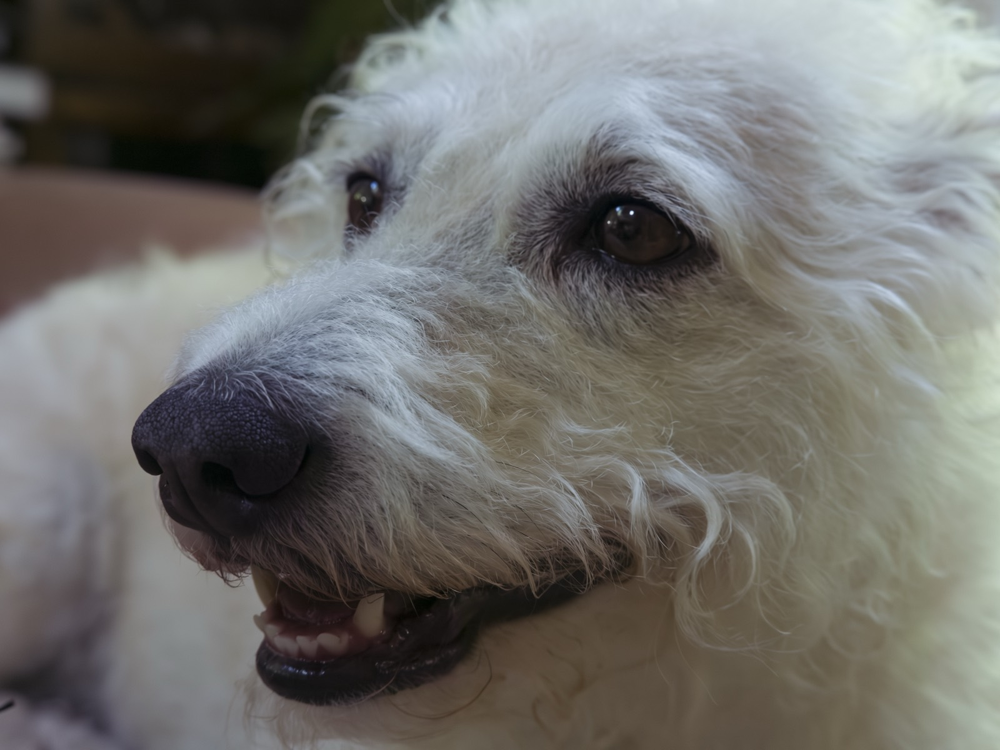

# Hasselblad Focus Distance Retrofit

Lightroom and Capture One use the EXIF focus distance (SubjectDistance) to decide how much distance-dependent lens correction to apply. Hasselblad X2D II files get that value wrong in three ways: files shot before firmware 1.3.16.1 have no value at all, and files shot on later firmware can carry the distance in feet instead of metres (the field is defined in metres), the "Infinity" placeholder at close focus, or a stale value from an earlier frame.

Every X2D II file also records the lens's focal length and magnification in the maker note, and those are not affected by any of that. This tool works the distance out from them, using a per-lens calibration, and writes it into the file.

## Use it

One command, no options to learn:

```
python3 hb-focus-retrofit.py ~/Pictures/X2D-Import
```

Replace the path with your folder. The tool goes through every `.3FR` file in it, including subfolders, and for each one it computes the distance from the maker note. Then:

- **File already has a SubjectDistance tag** (firmware 1.3.16.1 and later): the tag is corrected in place, whatever it held before (feet, Infinity, a stale value, or a value that was already about right). Only those 8 bytes change. A frame with the focus ring at its infinity stop gets the standard Infinity value (see "Frames focused at infinity" below).
- **File has no tag** (older firmware): the tag cannot be added without restructuring the file, so the tool writes a copy under `retrofitted/` inside your folder, keeping your subfolder layout. The original is never opened for writing.
- **Distance cannot be computed**: the file is left alone and the report says why (see "Why was my file skipped?").

Run it a second time and nothing changes, because every file already carries the value the tool would write. To see what it would do first, add `--dry-run`:

```
python3 hb-focus-retrofit.py ~/Pictures/X2D-Import --dry-run
```

You get one line per file and a count at the end:

```
B0001201.3FR           rewritten: stored Infinity -> 1.629 m  (XCD 55V)
B0001202.3FR           rewritten: stored 1.730 -> 0.526 m  (XCD 55V)
day2/B0001203.3FR      unchanged (1.820 m, XCD 55V)
old/B0001204.3FR       copied with tag added: 0.637 m  (XCD 55V) -> retrofitted/
old/B0001205.3FR       skipped: no calibration for XCD 38V

Summary
  files found:                        5
  rewritten in place:                 2
  unchanged:                          1
  copied with tag added:              1
  ...
undo log: /Users/you/Pictures/X2D-Import/hb-focus-retrofit-undo-20261118T162323Z-<id>.jsonl
```

The exit code is 0 when no file had an error and 1 when any did. Skipped files are not errors.

## Current limitations

Read these before you run it on a whole archive.

- **Far focus is an estimate, not a calibrated value.** Each lens is only calibrated out to a few metres, because the reference distances so far came from the camera's own value, which it only records reliably at close range. A frame focused beyond that (but not at the infinity stop) gets thin-lens distance times the calibration ratio at the far end of the range, held constant, and is reported as "estimated, beyond calibration". No measured distance has checked these values. They exist because the camera's own value is no better out there: it flattens toward a ceiling (about 2.3 m on the XCD 25V, about 10 m on the 55V, about 12 to 14 m on the 90V in the author's archive) while the maker-note magnification keeps falling. On three autofocus frames of subjects more than 20 m away (55V, firmware 1.4.15.7) the camera wrote 7.2 to 8.4 m; the thin-lens distance from the maker note is 14.5 to 22.6 m. See "Estimates beyond the calibrated range" below.

  | Lens | Calibrated from | to about |
  |---|---|---|
  | XCD 25V | 0.24 m | 2.1 m |
  | XCD 55V | 0.43 m | 2.9 m |
  | XCD 90V | 0.65 m | 3.1 m |
  | XCD 120 | 0.40 m | 2.3 m |
  | XCD 135 | 0.95 m | 3.8 m |

- **The XCD 25V estimate is the least certain of the five.** Its far-end ratio (about 0.24, so the tool writes roughly a quarter of the thin-lens distance) was derived from the camera's own values near its ceiling, not from a measured distance, and it is far from 1. Treat 25V estimates as the roughest of all.

- **Five lenses only.** Every other lens is skipped, including both E-series zooms. You can calibrate your own lens and contribute it (see "Calibrating your own lens").
- **One photographer's equipment.** All five calibrations come from one person's X2D II and one copy of each lens, on firmware 1.3.16.1 and 1.3.16.2. Copy-to-copy variation between lenses has not been measured.
- **Converters and extension tubes.** Frames shot through a converter are detected by focal length and skipped. Extension tubes cannot be detected, so keep tube frames out of the folder or undo them afterwards.
- **Files that were already right get rewritten too.** The camera rounds to centimetres and the tool writes millimetres, so most tagged files change by a few millimetres and get a new checksum and modification time, even when the camera's value was correct.
- **Catalogs are untested.** How Lightroom Classic, Capture One and Phocus react when a file they already have in a catalog is edited in place has not been tested.
- **Not tested on Windows.** The test suite runs on macOS and Linux. The tool is written to work on Windows, but nobody has run it on a Windows PC yet.

## What changes in your files

Read this part before pointing the tool at originals you care about.

- **In-place edits modify your original files.** For a file that already has the tag, the tool overwrites the 8 bytes that hold SubjectDistance. Nothing else in the file changes. I checked this on 16 real files from firmware 1.4.15.7: comparing each file with its original showed differences only inside that 8-byte field (4 to 6 bytes actually differed), and the file size was identical.
- **The file's checksum and modification time change.** The tool does not put the old modification time back, so backup tools, sync tools and Lightroom's "changed on disk" check will see a changed file. If you keep checksums of your originals, those are now out of date for the files that were rewritten.
- **Every in-place change is recorded in an undo log before the file is touched.** The log is a text file named `hb-focus-retrofit-undo-<date>-<run id>.jsonl`, written into the folder you passed. It holds the file path, the old 8 bytes and the new 8 bytes. A run that changes nothing writes no log.
- **Each write is checked.** Before writing, the tool reads the 8 bytes again and stops on that file if they are not what it saw a moment ago, or if the file size changed. After writing, it flushes to disk, reads the bytes back and checks the size again. If any check fails it puts the old bytes back where it can and reports an error for that file; the other files continue.
- **Files that are read-only are reported as errors, not forced.** The tool does not change permissions on your originals.

### What it does not do

The whole tool is one readable file, `hb-focus-retrofit.py`, and the source is open for anyone to check. It has no networking code at all: search the file for the words `urllib`, `socket`, and `requests` and you won't find any of them. Nothing about your files or your usage is collected or sent anywhere. [PRIVACY.md](PRIVACY.md) spells out exactly what this project does and does not receive.

### Undoing it

```
python3 hb-focus-retrofit.py undo "/path/to/hb-focus-retrofit-undo-20261118T162323Z-<id>.jsonl"
```

For each entry in the log, the old 8 bytes go back, but only if the file still has the new bytes from that run and the same size. If a file was changed again since, or is gone, or has a different size, that entry is skipped and reported, and the file is left as it is. Running `undo` twice is safe: the second time it reports "already restored". Undo restores the bytes, so the file is byte-identical to the original again, but it does not restore the modification time.

The copies under `retrofitted/` are not covered by the log. To undo those, delete the `retrofitted` folder.

### Frames focused at infinity

When the focus ring is at its infinity stop, the maker note reports a magnification of exactly 0 together with a non-zero focal value. The tool writes SubjectDistance as the EXIF standard's infinity (numerator 0xFFFFFFFF, denominator 1, the same bytes the camera writes when it knows the distance is infinite), whatever the file held before. This needs no lens calibration, so it also applies to lenses that are skipped for every other distance. Frames shot a little short of the stop have a small non-zero magnification and go through the calibration like any other frame.

A frame where the focal value is zero as well is not at infinity: the camera lost its focus data, and the tool leaves that file alone ("No focus data" below).

### Why was my file skipped?

The report names the reason and the summary counts each one separately.

- **No focus data.** The maker note has no focus fields (firmware before 1.2.7.11), or all of them are zero (the camera lost them, which has been seen on firmware 1.2.7.16, 1.3.16.1 and 1.3.16.2), or the focal length is implausible against the file's nominal focal length. There is nothing to compute from, and whatever the camera stored stays in the file.
- **Infinity, no tag to correct.** The frame is focused at infinity but has no SubjectDistance tag (firmware before 1.3.16.1). There is no wrong value to fix, so no copy is made.
- **No calibration for the lens.** The distance depends on a per-lens calibration and this lens does not have one yet. This includes the XCD 20-35E and XCD 35-100E zooms. The tool does not guess with the raw optics formula in this mode.
- **Closer than calibrated range.** The magnification is larger than the calibration was measured at (an extreme close-up). The tool leaves these alone rather than write a number it cannot support.
- **Computed distance beyond 1 km.** The magnification is so small that the thin-lens distance exceeds 1 km, which is effectively infinity but not the infinity stop. Nothing is written.

Frames focused beyond the far end of the calibration are not skipped: they get an estimate, see "Estimates beyond the calibrated range".
- **Focal length outside calibration (converter?).** The maker-note focal length is more than 10 percent outside the range the lens was calibrated at, which usually means a converter is attached.
- **Symlink.** Symbolic links to files are not followed, so the tool never edits a file outside the folder you gave it.

Dot-folders (such as `.sync`) and the tool's own `retrofitted` folder at the top level are not scanned, and hidden files whose names start with a dot (the `._B0001.3FR` files macOS makes on some cards and network drives) are ignored.

### Calibrated lenses

The calibration for each lens comes from ladders shot on X2D II bodies and is keyed on the magnification in the maker note. A file inside the range gets a calibrated value; a file focused farther than the range gets an estimate; a file closer than the range is skipped.

| Lens | Calibration points | Magnification range |
|---|---|---|
| XCD 25V | 41 | 0.00297 to 0.17161 |
| XCD 55V | 26 | 0.01803 to 0.15353 |
| XCD 90V | 23 | 0.02993 to 0.1724 |
| XCD 120 | 29 | 0.05453 to 0.4992 |
| XCD 135 | 15 | 0.0364 to 0.17181 |

To add a lens, see "Calibrating your own lens" below.

### Estimates beyond the calibrated range

When the maker-note magnification is positive but smaller than the far end of the calibration, the tool writes thin-lens distance times the calibration ratio at the far end of the range, held constant, in place (8 bytes, undo log, whatever value was stored, same as a calibrated frame). The report line says "estimated, beyond calibration" and the summary counts these frames on their own lines. If the stored value already equals the estimate to the tool's rounding, the frame is counted as unchanged. `inspect` shows the estimate and the far end of the calibration for a frame like this. The undo log records `"new_kind": "estimate"`; `undo` restores the old bytes exactly, as for any other entry.

This is an estimate that no measured distance has checked. The ratio at the far end, and what it writes at a few thin-lens distances:

| Lens | Calibrated out to (magnification, camera distance) | Ratio held | Written at thin-lens 5 / 10 / 20 / 50 m |
|---|---|---|---|
| XCD 25V | 0.00297, 2.1 m | 0.242 | 1.2 / 2.4 / 4.8 / 12.1 m |
| XCD 55V | 0.01803, 2.9 m | 0.925 | 4.6 / 9.2 / 18.5 / 46.2 m |
| XCD 90V | 0.02993, 3.1 m | 1.023 | 5.1 / 10.2 / 20.5 / 51.1 m |
| XCD 120 | 0.05453, 2.3 m | 1.048 | 5.2 / 10.5 / 21.0 / 52.4 m |
| XCD 135 | 0.0364, 3.8 m | 1.022 | 5.1 / 10.2 / 20.4 / 51.1 m |

How much a wrong far distance can matter, from Adobe's lens profiles (a computation, not a measurement in Lightroom): comparing the last finite profile distance against infinity, the largest effect is about 30 px of distortion at the frame corner on each of the XCD 25V, 55V and 90V, and 0.02 / 0.06 / 0.22 stops of vignetting at f/2.5 respectively. A factor-of-two error in distance at 10 m costs about 6 / 12 / 16 px of corner distortion. Those are the upper bounds for the distance error alone.

### Which value gets written

The distance is stored as a standard EXIF rational number: the distance in metres times 1000, over 1000 (so 1.629 m is stored as 1629/1000), in the file's own byte order. The same encoding is used for the in-place edit and for the tag added to older files.

## Before and after

The images below show a frame from before firmware 1.3.16.1, which has no distance at all, so it goes through the copy path. The same effect applies to a file whose distance was wrong.

**Before**, the file as your archive has it today. Lightroom has no focus distance to work from, so it corrects the lens as though you focused far away:



**After**, the same RAW frame with the focus distance filled in by this tool:


Both images come from one frame: a Hasselblad X2D II with the XCD 55V, focused at about 0.64 meters, shot on firmware 1.2.7.16 (before the camera recorded focus distance itself). Nothing was changed in Lightroom between the two, and the RAW image data is byte for byte identical. The only difference is the focus distance the file carries.

## What you need

- A Mac, a Windows PC, or a Linux machine.
- Python 3.9 or later. Most Macs already have this. If yours doesn't, the steps below will tell you exactly what to do.
- Nothing else. This tool doesn't need any extra libraries or installers beyond Python itself, there's no separate "install" step for the tool.

The rest of this guide is written for a Mac, since that's the most common setup for Hasselblad shooters. Windows notes are called out separately wherever the steps differ, but there's one substitution that applies everywhere: **on Windows, type `python` wherever this guide shows `python3`.** Also, any path that starts with `~/` (like `~/Desktop`) is Mac shorthand for your home folder; on Windows the equivalent looks like `C:\Users\yourname\Desktop`, or you can just drag the folder into the window as described below and skip typing the path by hand entirely.

### Checking you have Python (Mac)

Terminal is just a window where you type instructions instead of clicking buttons. Typing a command here cannot break your Mac. The main command does edit your files, so read "What changes in your files" above before you run it for real; `--dry-run` shows what it would do without changing anything.

1. Open **Terminal**. You'll find it in `Applications > Utilities > Terminal`.
2. Type this and press Return:

```
python3 --version
```

3. If you see something like `Python 3.11.5`, you're set, skip ahead to **Quick start**.
4. If instead a dialog pops up asking to install "command line developer tools," click **Install**. This is Apple's own toolkit, not something from this project, and it includes Python. It takes a few minutes. Once it finishes, run `python3 --version` again to confirm.

### Checking you have Python (Windows)

1. Open **PowerShell**. Click the Start menu, type `PowerShell`, and press Return on "Windows PowerShell."
2. Type this and press Return:

```
python3 --version
```

3. If you see something like `Python 3.11.5`, you're set. If Windows says it doesn't recognize `python3`, try `python --version` instead, some Windows installs use that name.
4. If neither command works, install Python from [python.org/downloads](https://www.python.org/downloads/). During setup, check the box that says "Add Python to PATH," this is what lets Terminal/PowerShell find it afterward.

## Quick start

Reminder: on Windows, type `python` instead of `python3` in every command below, and use your own folder's real path instead of the Mac-style `~/Desktop/...` examples.

**1. Get the code.**

The easiest way, no prior tools needed: go to [github.com/kmichels/hasselblad-focus-retrofit](https://github.com/kmichels/hasselblad-focus-retrofit), click the green **Code** button, choose **Download ZIP**, and unzip it. GitHub usually names the unzipped folder `hasselblad-focus-retrofit-main` (with `-main` on the end), not just `hasselblad-focus-retrofit`, so check the exact name in Finder or File Explorer before the next step.

If you already use git, cloning works too:

```
git clone https://github.com/kmichels/hasselblad-focus-retrofit.git
```

That gives you a folder named exactly `hasselblad-focus-retrofit`, no `-main` suffix.

**2. Move into that folder.** (If you come back to this later in a new Terminal/PowerShell window, you'll need to repeat this step first, a new window always starts back at your home folder.)

Use the folder name you actually see on disk. If you downloaded the ZIP:

```
cd hasselblad-focus-retrofit-main
```

If you used git clone:

```
cd hasselblad-focus-retrofit
```

If either command says something like "no such file or directory," you're not in the right starting location, or the folder has a different name than expected. Type `cd ` (with a trailing space, no Return yet), then drag the folder itself from Finder or File Explorer into the Terminal/PowerShell window. It will fill in the exact path for you. Then press Return.

**3. Make sure the folder is backed up.** The tool edits files in place, so run it on files that exist somewhere else too. Copying the 3FR files off the card into a working folder first is the usual way.

**4. Preview, then run.** Type `python3 hb-focus-retrofit.py ` (with a trailing space, don't press Return yet), drag your folder from Finder or File Explorer into the window so the real path is filled in, add ` --dry-run`, and press Return. The report shows what would happen and writes nothing. When it looks right, run the same command without `--dry-run`.

**5. Re-import.** If Lightroom or Capture One already has these files in a catalog, they need to notice that the metadata changed. I have not tested how either one handles that, so check on one file first: look at the focus distance Lightroom shows for it (Metadata panel) before and after re-reading metadata or re-importing. Files that went to `retrofitted/` are new files and import as new files.

## Warning: converters, extension tubes, and zooms fool this tool

If you shoot a lens through the X Converter 1.7, any teleconverter or extension tube, or either of the XCD E-series zooms (XCD 20-35E, XCD 35-100E), keep those frames out of the folder you give the tool. Zooms are skipped for want of a calibration. Converters are caught by a focal-length check (below), extension tubes are not. Both come from the same root cause: something that changes the optics isn't captured by the calibration key. The calibration only looks at the lens name in the file (`LensModel`), and that name doesn't change when a converter is attached or when a zoom moves off the focal length it was calibrated at.

**Converters and extension tubes.** The camera writes the same lens name to the file whether the converter is attached or not. The shipped `calibration/xcd-135.json` was measured on the bare XCD 135 only. A frame shot with the XCD 135 plus the X Converter 1.7 reports the same "XCD 135" lens name, but the effective focal length is roughly 203 to 221 mm instead of the bare lens's 127 to 132 mm. Nothing in the file tells the tool which one it's looking at, so the lens name alone cannot tell them apart. What does differ is the focal length in the maker note, so the tool compares it with the focal lengths the calibration was measured at. A frame more than 10 percent outside that range is skipped as "focal length outside calibration (converter?)" and its file is left alone. That catches the 1.7x converter. Extension tubes change the optics without changing the focal length much, so the check cannot see them: a frame shot with a tube gets the bare-lens distance written in place, replacing whatever the camera wrote, and Lightroom and Capture One will apply corrections using it.

If you shoot the 135 with the 1.7x converter, keep those frames out of the folder, or reverse the change for them afterward with `undo`. The same goes for extension tubes. The same caution applies to any lens used with a converter or extension tube where a calibration exists for the bare lens: the tool cannot tell the two apart and will pick the wrong curve.

Separately, converter frames also make poor material for building your own calibration ladder in the first place. With the converter attached, the camera's own reported focus distance stops tracking somewhere between roughly 1.7 and 3 meters. Five consecutive test frames all reported 1.66 m while the lens was demonstrably focusing further out. If you're building a calibration for a converter setup, expect that range to be unreliable and check your residuals carefully.

**The XCD 20-35E and XCD 35-100E zooms.** Calibration in this tool is a single curve per lens keyed on magnification, and that only holds when focal length is fixed. On a zoom it isn't. At a given magnification, 20 mm and 35 mm are different optical situations that want different corrections, so one curve cannot describe both. A ladder shot at a single focal length would produce a calibration correct at that setting and wrong at every other one, which is worse than no calibration at all, so neither zoom ships with one. Zoom frames are skipped with "no calibration", same as any other lens without a curve. A correct fix needs a calibration surface across focal length, not a single curve, and that's future work, not something you can work around by shooting a ladder at one focal length today.


## Calibrating your own lens

If your lens isn't calibrated yet, you can build a calibration yourself in a few minutes:

1. Update your camera's firmware to 1.3.16.1 or later. Newer firmware reports its own focus distance, which is what you'll calibrate against.
2. Shoot a distance ladder: about 10 frames spread between your lens's minimum focus distance and roughly 3 meters. **Use autofocus, and physically move the camera or the target between frames.** The steps do not have to be evenly spaced and you never need to measure anything, just let AF lock at a different distance each time. Shoot wide open. Any subject works, a tripod is optional, and sharpness doesn't matter, you're only using the distance the camera reports, not the image content.

   One important caveat, learned from a contributor's camera (X2D II + 38V): the camera only *latches* a focus distance on some AF acquisitions, resets it to "no distance recorded" (SubjectDistance = 4294967295) on every lens change, and can keep re-stamping a stale latched value on later frames even as focus genuinely moves. Frames shot right after mounting a lens, or focused by racking the focus ring, may record no distance at all, and a ladder shot without fresh AF locks can record the *same wrong* distance on every rung. The calibrate step rejects both cases, but save yourself the reshoot: **before committing to a full ladder, shoot 2-3 test frames and check the card** with `exiftool -s3 -SubjectDistance *.3FR`. Each frame should show a different, plausible distance. If you see 4294967295 or one identical value repeating, the latch isn't refreshing; a settings reset has helped in the field, and re-locking AF on a moved target for every single frame is the procedure that works.
3. Put those frames in their own folder (one lens per folder) and run:

```
python3 hb-focus-retrofit.py calibrate --source ~/Desktop/55V-Ladder --contributor "Your Name"
```

`--contributor` records your name or handle in the calibration file so you get credit if you submit it. The tool prints the absolute path of the file it just wrote, so you know exactly where to find it, for example `wrote /Users/you/Desktop/xcd-55v.json (7 points, lens XCD 55V)`.

4. The tool prints residuals, meaning how far off the fitted curve is from each of your measured points, as a percentage. Under 2% means your ladder shots were consistent enough to trust; higher than that usually means a step in the ladder was off (wrong distance, wrong lens selected, that kind of thing), and it's worth reshooting.
5. Share it with the project: no GitHub account? Email the file to hasselblad@agentmail.to instead. Otherwise, open a GitHub issue with the resulting calibration file's contents pasted in, or open a pull request adding it under `calibration/<lens-name>.json` (for example, a 90V calibration would be `calibration/xcd-90v.json`, following the same naming pattern as the shipped `calibration/xcd-55v.json`). See `CONTRIBUTING.md` for the exact steps.

### Calibrating with measured distances

The ladder above can only reach as far as the camera writes a real distance, which is about 3 m on most frames (some firmware 1.4.15.7 autofocus frames carry real values well past that). To go further you need distances you measured yourself, for example with a laser measure, taken from the focal plane mark (the Φ symbol on the body). Shoot two or three autofocus frames per mark, re-locking focus on something else before each one, and sort them into one subfolder per mark, named by the exact reading:

```
55V/1.000m/   55V/2.000m/   55V/9.987m/   55V/20.000m/
```

Then run:

```
python3 hb-focus-retrofit.py calibrate --source ~/Desktop/55V --measured --contributor "Your Name"
```

The folder name is the true distance, so it doesn't matter that the camera writes Infinity past a few metres. Each mark becomes one point. Besides the residuals, the tool prints an overlap table: for every mark it shows your measurement, the camera's own value where it wrote one, and what the shipped calibration predicts. On the near marks those three should agree; if they don't, the reference point is off and the far points shouldn't be trusted. The result goes to `<lens>-measured.json` and covers only the distances you measured, so don't copy it over a shipped calibration. To extend the shipped curve yourself, add `--merge-shipped`: it keeps every shipped point for the lens, adds the measured marks that lie beyond the shipped range, uses the marks inside it only for the overlap check, and writes `<lens>-merged.json`. The overlap table also shows each camera and shipped value as a percentage off your measurement. Review it before copying anything into `calibration/`.


## FAQ

**Does this change my original files?**
Yes, for files that already have a SubjectDistance tag: the 8 bytes holding that value are overwritten, and nothing else in the file changes. The checksum and modification time of those files change, and an undo log records the old bytes. Files with no tag (before firmware 1.3.16.1) are never modified; they get a copy in `retrofitted/`. See "What changes in your files" above.

**What about FFF files?**
Not supported yet, and untested. Stick to 3FR for now.

**Which cameras does this work with?**
Verified on the Hasselblad X2D II (100C sensor). The tool checks for the presence of the right data fields rather than checking the camera model by name, so other Hasselblad bodies with similar maker-note data may work too, but nobody has confirmed that yet. If you try it on another body, please report the result (working or not) via a GitHub issue.

**Does this affect Phocus?**
It does not change how Phocus renders the file. Phocus does not read the field this tool writes, and a test on 2026-08-01 rendered the same file bit-exact in Phocus 4.2.1 before and after a distance was added (see EVIDENCE.md). That test was on a copy with the tag added; I have not separately tested Phocus on a file whose tag was rewritten in place and whose modification time changed.

**Do my Lightroom edits carry over to the retrofitted copies?**
Only for the copies in `retrofitted/` (older files with no tag), and not automatically: Lightroom treats a copy as a new import with no edit history. Either copy your Lightroom settings across (Lightroom's "Sync Settings" or "Copy/Paste Settings" work for this), or run this tool before you start editing. Files edited in place keep their name and location. How Lightroom treats an already-catalogued file whose metadata changed on disk has not been tested for this tool, so try one file first.

**What happens if my camera or firmware isn't supported?**
Files that don't have the data this tool needs are skipped, with the reason printed in the report, they're never guessed at or written to. This is the same behavior whether the reason is old firmware, a different camera body, or anything else the tool doesn't recognize. You just won't get a corrected focus distance for those files.

**Why was my file skipped?**
See "Why was my file skipped?" above: no focus data, no calibration for the lens, closer than the calibrated range, computed distance beyond 1 km, or a symlink.

## Troubleshooting

**`python3: command not found`**
Python isn't installed, or Terminal can't find it. On a Mac, run `python3 --version` as described above under "Checking you have Python" and follow the install prompt. On Windows, install Python from python.org and make sure to check "Add Python to PATH" during setup.

**macOS says the file "cannot be opened because it is from an unidentified developer," or a permission dialog appears when your files are on an external drive**
This is macOS's standard quarantine warning for anything downloaded from the internet, and its standard permission prompt for accessing removable drives. It's not specific to this tool. Go to **System Settings > Privacy & Security** and allow the item, or grant Terminal access to the external drive when prompted, then try the command again.

**Windows shows a blue "Windows protected your PC" screen (SmartScreen)**
This is Windows' standard warning for files downloaded from the internet, not something specific to this tool. If you see it, click **More info**, then **Run anyway** (or just proceed with unzipping, depending on which step triggered it).

**"no 3FR files found"**
The folder you pointed at has no `.3FR` files anywhere under it (the tool looks in subfolders too, but not in folders whose names start with a dot), or you pointed at the wrong folder. Double-check the path, for example by dragging the folder from Finder into Terminal after typing `python3 hb-focus-retrofit.py ` to have Terminal fill in the correct path for you.

**"error: not a folder"**
The path does not exist or is a file. The tool takes a folder, not a single file. To look at one file, use `python3 hb-focus-retrofit.py inspect FILE.3FR`.

**Terminal says it can't find `hb-focus-retrofit.py`**
This happens if you closed Terminal/PowerShell and opened a new window later, a new window doesn't remember where you were. You need to move back into the tool's folder first, the same as step 2 in Quick start: type `cd ` (with a trailing space), then drag the tool's folder from Finder or File Explorer into the window, then press Return. After that, the commands work again.

## The older copies-only commands

Before version 0.2.0 the only way to run the tool was the `retrofit` command, and it still works unchanged: it never touches your originals, writes copies into a `retrofitted` folder (or `--dest`), skips files that already have a tag, does not look in subfolders, needs `--apply` to write anything, and for a lens with no calibration it falls back to the raw thin-lens formula and marks the line UNCALIBRATED.

```
python3 hb-focus-retrofit.py retrofit --source ~/Desktop/X2D-Import
python3 hb-focus-retrofit.py retrofit --source ~/Desktop/X2D-Import --apply
```

The raw formula assumes an ideal thin lens, and real lenses are not. This is how far off it is for the XCD 55V, measured against the camera's own values on newer firmware:

| Distance | Raw formula error |
|---|---|
| 0.44 m | -15% |
| 0.62 m | -12.5% |
| 1.10 m | -8.5% |
| 1.48 m | -5.7% |
| 2.14 m | +0.2% |
| 2.91 m | +8.2% |

Other lenses lean differently (a single XCD 90V frame read +9% high at 0.5 m), which is why the folder mode skips lenses without a calibration instead of using the raw formula.
